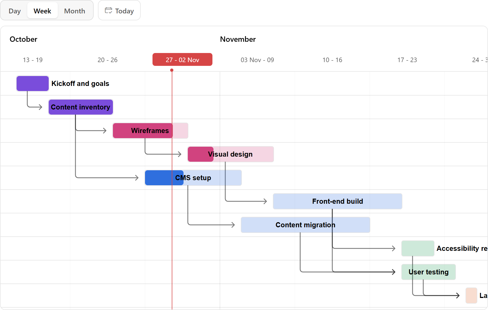

# Gantt Chart for Oracle APEX

Project tasks on a timeline that users reschedule by dragging, saved with your own PL/SQL.

[](https://oracleapex.com/ords/r/aamirkhanz/plugins/gantt) &nbsp; Sign in as `demo` with the password `Demo`.



| | |
|---|---|
| **Type** | Region plug-in |
| **Internal name** | `COM.TECHREVX.GANTT` |
| **Version** | 1.0 |
| **Requires** | Oracle APEX 26.2 or later |
| **License** | MIT |

## What it does

Gantt Chart shows tasks from any query on a timeline: projects, production runs, rentals, rotas. Users reschedule by dragging, and your PL/SQL saves each change.

- **Timeline**: hour to year scales with view buttons, a Today button, today's line and shaded weekends.
- **Dependencies**: arrows between tasks; moving a task moves the tasks that wait for it.
- **Editing**: drag a bar to move it, drag its ends to change its length, drag the handle to change the progress. Turn each one off for read-only plans.
- **Saving**: the Save Code gets the task and its new dates and progress as real DATE and NUMBER values. If it raises an error, the change is rolled back, the bar goes back and your message is shown.
- **Progress**: the done part of each bar in the task's color, and optionally a line for how far it should be by today.
- **Accessible**: the tasks are also in a table that screen readers can read.

## At a glance

- **Source**: any region source with one row per task. Map ID, Name, Start and End; Progress, Dependencies, Color and Description are optional.
- **Timeline**: Hour, Quarter Day, Half Day, Day, Week, Month and Year views with view buttons, a Today button, today's line, weekend shading, dependency arrows, expected progress and a details popup.
- **Editing**: drag a bar to move it, drag its ends to change its length, drag the handle to change progress; tasks that depend on it move along. The Save Code gets :ID, :START_DATE, :END_DATE and :PROGRESS; if it fails the task goes back and its message is shown.
- **Options**: skip weekends in durations, bar height, chart height, Set Item on Click. JavaScript: apex.region( "id" ).refresh(), changeViewMode( "Month" ), scrollToToday(), getTasks(). Events: Gantt - Task Clicked, Task Changed, View Changed.

## Installation

1. Download `plugin/region_type_plugin_com_techrevx_gantt.sql` from the [latest release](https://github.com/aamirkhanz/apex-plugin-gantt-chart/releases/latest) (or from this repository).
2. In App Builder, open your application and go to **Shared Components > Plug-ins**.
3. Choose **Import**, select the file and finish the wizard.
4. Create a region of type **Gantt Chart [Plug-in]**, write the query and map ID, Name, Start and End.

Everything the plug-in needs is inside the SQL file, including Frappe Gantt; it loads nothing from other sites.

## Example

```sql
select task_id, task_name, start_date, end_date, pct_done,
       ( select listagg( predecessor_id, ',' ) from task_links l where l.task_id = t.task_id ) as depends_on,
       case phase when 'BUILD' then '#2f6fde' when 'TEST' then '#1f9d55' end as color,
       'Owner: ' || owner as description
  from project_tasks t
 where project_id = :P70_PROJECT
 order by start_date
```

```sql
-- Save Code
update project_tasks
   set start_date = :START_DATE,
       end_date   = :END_DATE,
       pct_done   = :PROGRESS
 where task_id = :ID;
```

:ID is checked against the region's own query before the Save Code runs, and only the bind variables your code uses are passed.

## Attributes

### Tasks

| Attribute | Type | Default | Description |
|---|---|---|---|
| **ID Column** (required) | Region source column |  | Unique key of each task, used by Dependencies and available as :ID in the Save Code. |
| **Name Column** (required) | Region source column |  | Text on the bar. |
| **Start Column** (required) | Region source column |  | First day (or time) of the task. Text values use the format YYYY-MM-DD or YYYY-MM-DD HH24:MI. |
| **End Column** (required) | Region source column |  | Last day of the task, included: a task from 3 to 5 March lasts three days. With a time, the task ends at that time. |
| **Progress Column** | Region source column |  | Percent done, 0 to 100, shown as the filled part of the bar. |
| **Dependencies Column** | Region source column |  | IDs of the tasks this task waits for, separated by commas. Each one is drawn as an arrow, and dragging a task moves the tasks that depend on it. |
| **Color Column** | Region source column |  | CSS color of the bar, for example #2f6fde or a phase color. The progress is drawn in the full color, the rest lighter. |
| **Description Column** | Region source column |  | Text in the details shown when a task is clicked, for example the owner. |

### Chart

| Attribute | Type | Default | Description |
|---|---|---|---|
| **View Modes** | Checkboxes | `day:week:month` | The time scales users can switch between with the view buttons. Values: `hour` Hour, `quarterDay` Quarter Day, `halfDay` Half Day, `day` Day, `week` Week, `month` Month, `year` Year. |
| **Initial View** (required) | Select list | `week` | The time scale shown first. The chart scrolls to today. Values: `hour` Hour, `quarterDay` Quarter Day, `halfDay` Half Day, `day` Day, `week` Week, `month` Month, `year` Year. |
| **Features** | Checkboxes | `toolbar:today:dates:progress:popup` | View Buttons: switch between the View Modes. Today Button: scrolls to today. Change Dates: drag a bar to move it, drag its ends to change its length. Change Progress: drag the handle under the bar. Expected Progress: a line showing how far the task should be by today. Skip Weekends: Saturdays and Sundays are not counted in a task's length. Details on Click: a popup with the dates, duration and description. Values: `toolbar` View Buttons, `today` Today Button, `dates` Change Dates, `progress` Change Progress, `expected` Expected Progress, `weekends` Skip Weekends, `popup` Details on Click. |
| **Height** (required) | Integer | `460` | Height of the chart; it scrolls inside. 0 makes it as tall as all its rows. |
| **Bar Height** (required) | Integer | `28` |  |
| **Set Item on Click** | Page item |  | Page item set to the task's ID when a task is clicked, before Gantt - Task Clicked fires. Use it to open a form for the task. |

### Saving

| Attribute | Type | Default | Description |
|---|---|---|---|
| **Save Code** | PL/SQL code |  | PL/SQL run after a task's dates or progress are changed. :ID is the task, :START_DATE and :END_DATE are DATE values (END_DATE is the last day, included) and :PROGRESS is 0 to 100. If it raises an error, the task goes back and the message is shown. Leave empty to only fire Gantt - Task Changed. |

## Events

Available in Dynamic Actions, and as jQuery events on the region or item:

- **Gantt - Task Changed** (`tx-gantt-change`)
- **Gantt - Task Clicked** (`tx-gantt-click`)
- **Gantt - View Changed** (`tx-gantt-view`)

## Save Code

Runs after each change. When a task moves the tasks that depend on it, it runs once for each of them, one after the other.

```text
:ID          the task's ID, checked against the region's query first
:START_DATE  DATE, the first day (with a time in the Hour views)
:END_DATE    DATE, the last day, included
:PROGRESS    NUMBER, 0 to 100
```

```sql
-- refuse changes that break a rule: the change is rolled back and the bar goes back
begin
    if :END_DATE > ( select deadline from projects where project_id = :P70_PROJECT ) then
        raise_application_error( -20000, 'The task would end after the project deadline.' );
    end if;
    update project_tasks
       set start_date = :START_DATE, end_date = :END_DATE, pct_done = :PROGRESS
     where task_id = :ID;
end;
```

Dates in the query can be DATE, TIMESTAMP or text in the format YYYY-MM-DD (or YYYY-MM-DD HH24:MI). A task needs a start and an end; a task that starts and ends on the same day lasts that day.

## Events and JavaScript

```text
Gantt - Task Clicked   this.data = { id, task }
Gantt - Task Changed   after a change was saved; this.data = { id, start, end, progress }
Gantt - View Changed   this.data = { mode }
```

```javascript
apex.region( "plan" ).refresh();                 // read the query again
apex.region( "plan" ).changeViewMode( "Month" );  // Hour, Quarter Day, Half Day, Day, Week, Month, Year
apex.region( "plan" ).scrollToToday();
apex.region( "plan" ).getTasks();                 // [ { id, name, start, end, progress, ... } ]
apex.region( "plan" ).getGantt();                 // the Frappe Gantt object, for its own options
```

### Styling

The chart takes the Universal Theme colors through Frappe Gantt's variables on `.tx-Gantt`, for example `--g-bar-color`, `--g-progress-color` and `--g-today-highlight`. A task with a color gets that color for its progress and a lighter one for the rest of the bar.

## Included libraries

| Library | Version | License |
|---|---|---|
| [Frappe Gantt](https://frappe.io/gantt) | 1.2.2 | MIT |

See [THIRD-PARTY-NOTICES.md](THIRD-PARTY-NOTICES.md).

## Repository contents

- `plugin/region_type_plugin_com_techrevx_gantt.sql`: the plug-in, ready to import
- `src/`: the plug-in's own source (PL/SQL in `plugin.pls`, JavaScript and CSS), for reading and reviewing; the SQL file already contains it
- `apexplugin.json`: the plug-in's details for [apex.world](https://apex.world)

## License

MIT, see [LICENSE](LICENSE). The included libraries keep their own licenses.

## More plug-ins

Documentation, updates and more plug-ins for Oracle APEX: [www.techrevx.com](https://www.techrevx.com)
